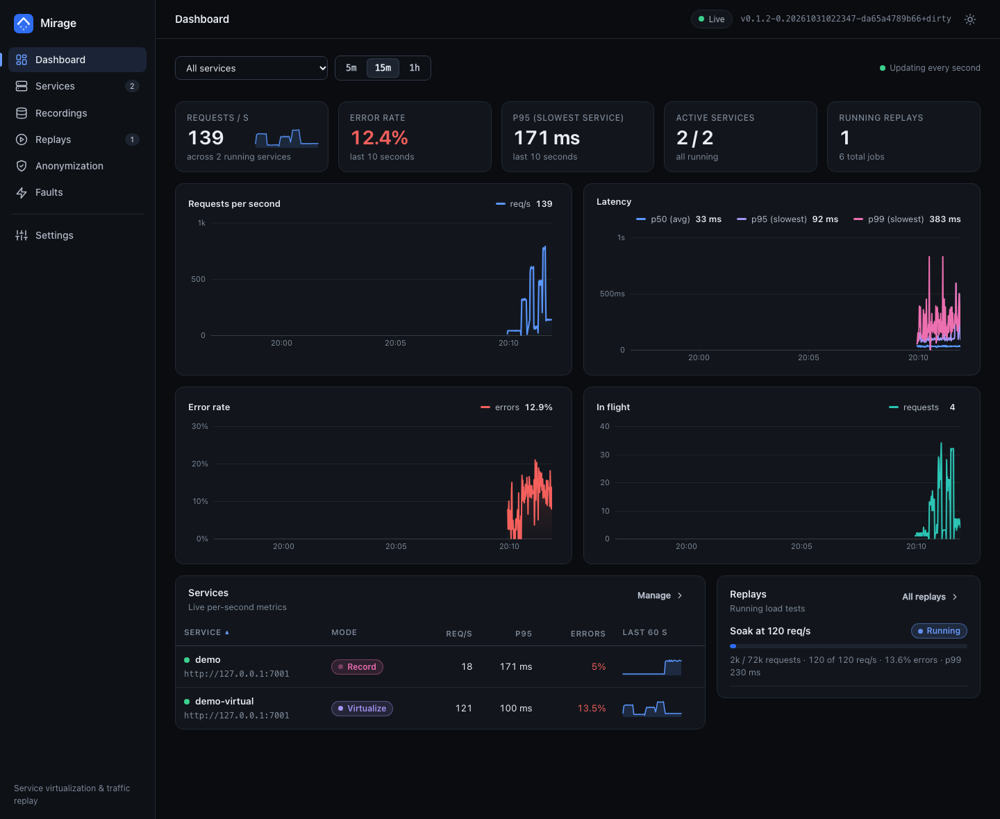
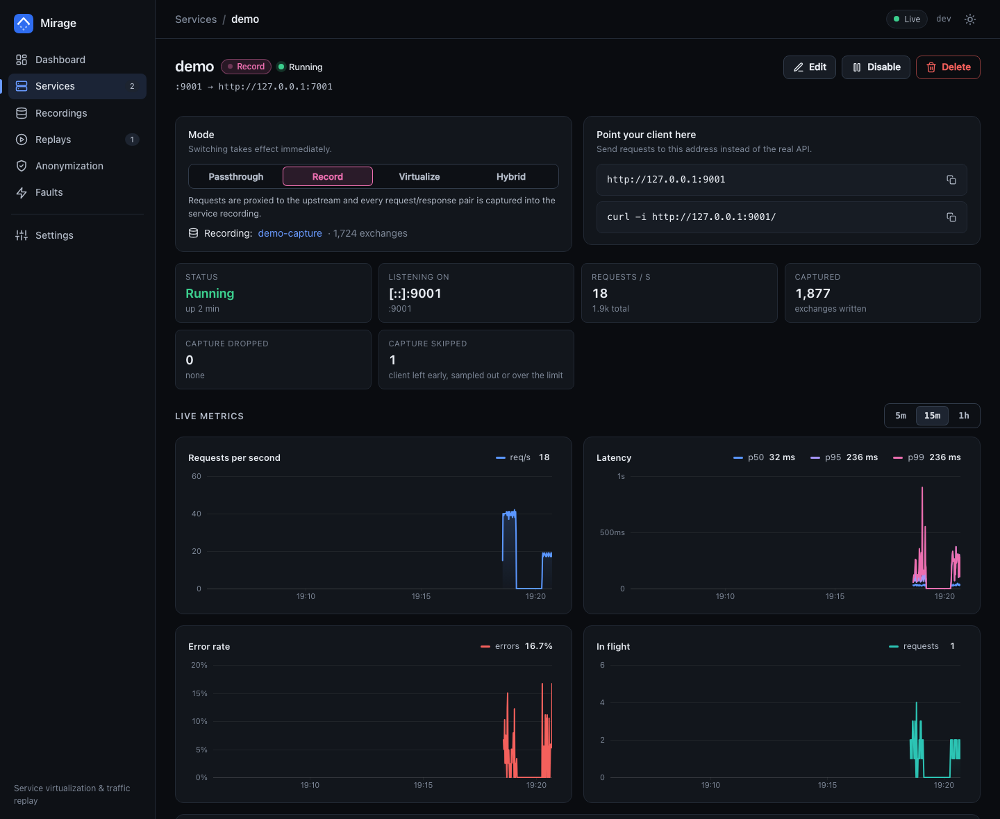
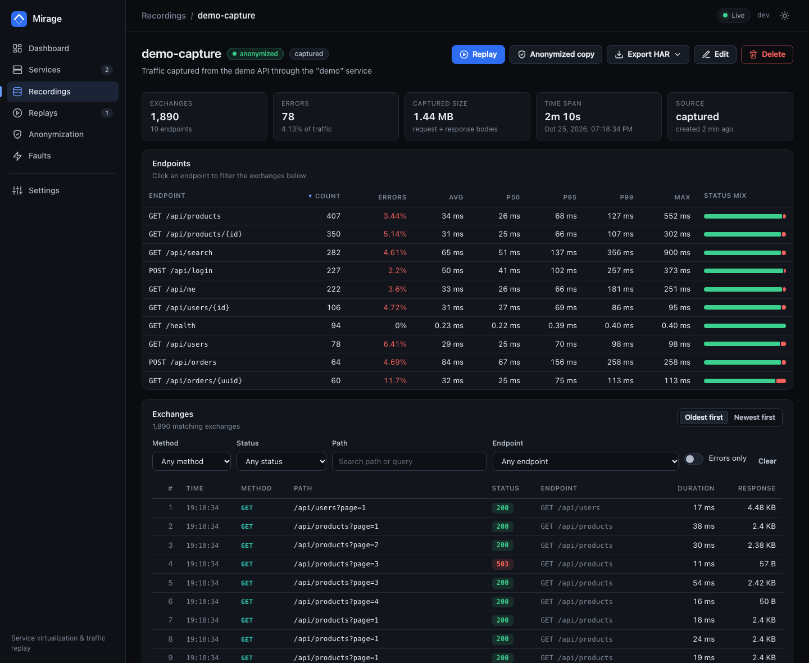
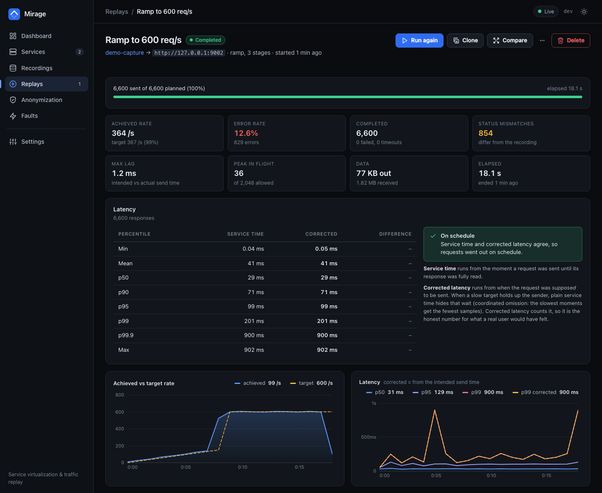
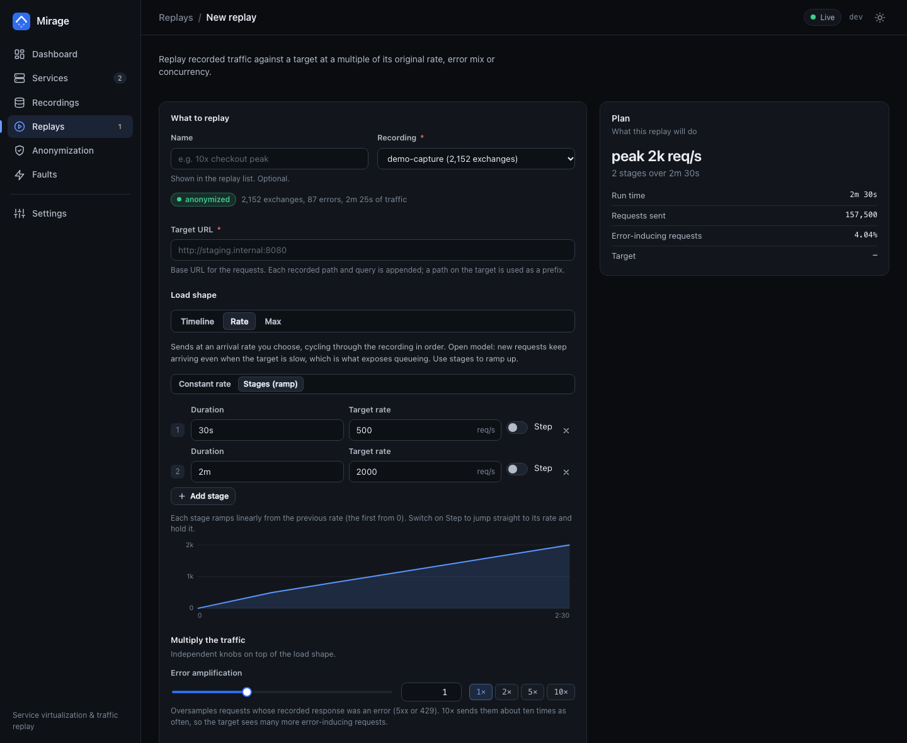
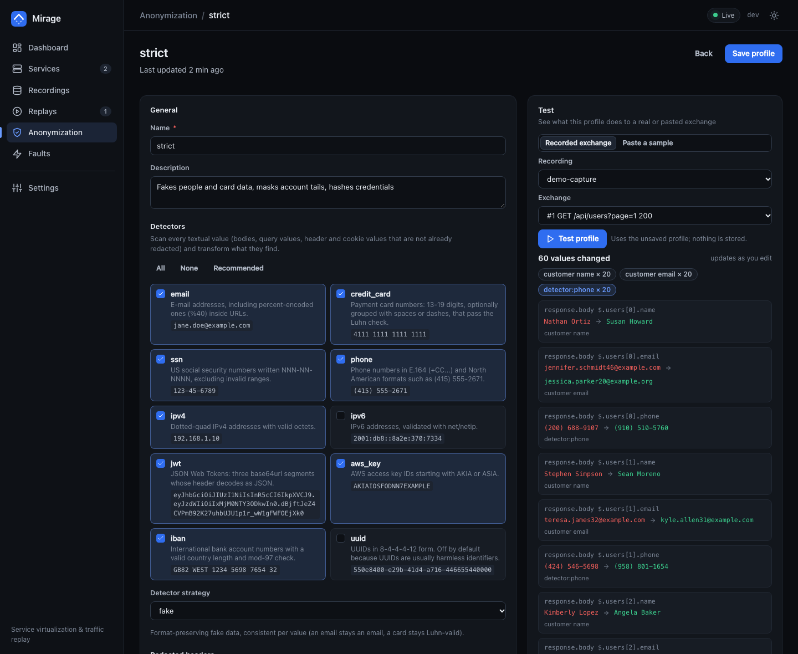
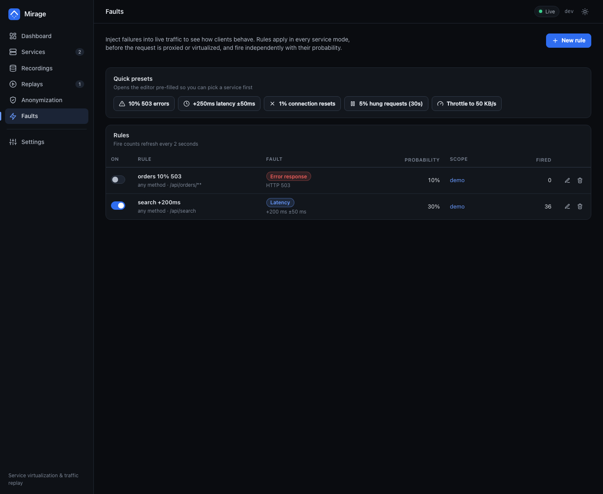

# Mirage

Service virtualization and traffic replay for performance testing, in one Go
binary with a built-in web UI.

Mirage sits between your clients and an HTTP API. It can pass traffic
through, **record** it, **serve it back without the real API**, inject
**faults**, **anonymize** what it captured, and **replay** that traffic as a
load test at a multiple of its original rate or error mix.



- **Record and virtualize.** Put a service in front of an API, record real
  traffic, then switch to virtualize: requests are answered from the recording
  with the recorded latency, and the real API is never contacted. Hybrid mode
  answers from the recording and proxies (and records) what it has not seen.
- **Turn the dial on the virtual service.** Multiply the recorded error rate per
  endpoint (`error_amplification`), add a floor, scale or fix the latency, or
  add fault rules (latency, errors, aborts, hangs, throttling) in any mode.
- **Replay as a load test.** Timeline mode keeps the recorded shape and
  compresses it (`--speed 10` is ten times the rate), rate mode follows a
  constant rate or staged ramp, max mode is a closed loop. Amplify copies,
  oversample the requests that produced errors, anonymize on the fly. The
  scheduler is open-model, and latency is reported both as service time and
  corrected for coordinated omission.
- **Anonymize deterministically.** Capture, copy, export and replay can all
  apply a profile (detectors for emails, cards, SSNs, JWTs, ... plus JSONPath,
  header, query, cookie, form, regex and path rules). `hash` and `fake` are
  keyed by the profile secret, so the same customer keeps the same fake
  identity in every request and response and cache hit ratios stay realistic.
  Names match ignoring case, `_` and `-` (a `password` rule covers `Password`
  and `user[password]`), the first matching rule wins, JSON inside JSON strings
  is rewritten too, and compressed bodies are decoded first so the profile sees
  what is inside.
- **CI friendly.** `mirage replay` is a headless load test with a live progress
  line, a summary table, a JSON result and exit codes for error-rate and p99
  thresholds.

## Quick start

```sh
make build                                    # bin/mirage (static, no cgo)
go run ./examples/demo-api -addr :7001 &      # a fake e-commerce API to play with
bin/mirage serve --config examples/mirage.yaml
go run ./examples/trafficgen -target http://127.0.0.1:9001 -rps 20 -duration 60s
```

Open <http://127.0.0.1:8484>. The example config defines one service, `demo`,
that records the demo API through `:9001` with anonymization on. (`make demo`
and `make traffic` do the same.)

Then, from the UI or the CLI:

```sh
# list what was recorded
bin/mirage recordings --data mirage.db

# switch the service to virtualize with the Mode switch in the UI (stop demo-api to prove
# it: recorded requests are still answered, with the recorded latency) ...

# ... and load test it, 10x faster, with 5x the errors
bin/mirage replay --data mirage.db --recording demo-capture --target http://127.0.0.1:9001 \
    --speed 10 --error-amplification 5
```

Docker: `docker build -t mirage . && docker run --rm -p 8484:8484 -v mirage-data:/data mirage`
(publish the service ports too, for example `-p 9001:9001`).

## The web UI

| | |
|---|---|
|  **Services.** Mode switch, live traffic, capture and virtualization counters, configuration. |  **Recordings.** Endpoints with latency and status mix, every exchange with bodies, HAR import and export, anonymized copies. |
|  **Replays.** Live and final results, service time next to corrected latency; [a saturated sender](docs/screenshots/replay-saturated.png) is called out. |  **New replay.** Timeline, rate (with stages) or max, with a live plan of what will be sent. |
|  **Anonymization.** Detectors and rules with a live test against a recorded exchange. |  **Faults.** Latency, errors, aborts, hangs and throttling, per service or global. |

The dashboard's "all services" view sums requests and errors, shows the
request-weighted mean for p50 and the **slowest service's** value for p95 and
p99 (labelled `p95 (slowest service)`, with the service named on hover): a
mean of percentiles is not a percentile and would hide a slow service behind a
fast busy one.

## Service modes

| Mode | What happens to a request |
|---|---|
| `passthrough` | proxied to the upstream; metrics and faults still apply |
| `record` | proxied, and the exchange is captured into the service's recording (optionally anonymized before it is written) |
| `virtualize` | answered from the recording; the upstream is never contacted; unmatched requests get `miss_status` (404 with a JSON body) |
| `hybrid` | answered from the recording when possible; misses are proxied, recorded and added to the live index |

Matching falls back from *exact* (method, path, query, body, chosen headers)
to *path* to *template* (`GET /users/7` answers with the recording of
`GET /users/42`). A service that records with `anonymize_capture` stores
anonymized requests, so in `virtualize` and `hybrid` mode it anonymizes each
incoming request with the same profile before it looks it up: a client that
sends `jane@acme.io` in the path or body still gets the response recorded for
that customer (a request that is already anonymized, such as a replay of the
recording, matches too). Editing the profile rebuilds the index of the
services that use it. Recording and replay never slow traffic down: capture is
a bounded queue that drops (and counts) when the disk cannot keep up.

## Commands

```
mirage serve        run the proxy services, the admin API and the web UI
mirage replay       replay a recording against a target as a load test
mirage anonymize    anonymize a HAR file or a stored recording
mirage import       import a HAR file as a recording
mirage export       export a recording as a HAR file
mirage recordings   list the recordings in a database
mirage version
```

`mirage <command> -h` shows every flag with examples.

### serve

```sh
mirage serve --config mirage.yaml                    # services, profiles, faults from a file
mirage serve --admin 0.0.0.0:8484 --admin-token s3cret --log-format json
```

The config file's `server:` section supplies defaults for `--admin`, `--data`,
`--admin-token`, `--allowed-host`, `--log-level` and `--log-format`; an explicit flag wins, and
`MIRAGE_ADMIN_TOKEN` beats the file. The rest of the file (recordings,
profiles, services, faults) is applied at start-up by name and is idempotent;
see [`examples/mirage.yaml`](examples/mirage.yaml) for every option. Because the
file is applied at every start, what it defines wins over changes made in the UI
to the same objects; drop a service from the file once you manage it in the UI.
SIGINT or
SIGTERM shuts down gracefully: listeners stop, the capture queue is flushed,
running replays are saved as stopped.

### replay (CI load tests)

```sh
mirage replay --data mirage.db --recording checkout --target http://staging:8080 \
    --mode max --concurrency 128 --duration 30s --loop \
    --json result.json --max-error-rate 0.01 --max-p99 250ms
```

```
  12s  sent 1,204,311 (41%)  98,114 rps  p50 1.1ms  p95 3.2ms  p99 9.8ms  errors 12 (0.00%)    <- stderr, once a second

Replay of "checkout" (rec_...) against http://staging:8080
max throughput, 128 workers, for 30s, looping

  Requests     sent 2,912,880 of unknown planned, completed 2,912,880, failed 0 (timeouts 0)
  Throughput   97,096.0 rps over 30.0s
  ...
Thresholds
  error rate     0.00%  <= 1.00%  PASS
  corrected p99  9.8ms  <= 250ms  PASS
```

Exit status: `0` success, `1` a threshold was exceeded or the run failed,
`2` bad command line (including a `--max-p99` that is not a positive duration,
a `--max-error-rate` that is not a number, a NaN or infinite `--rate`,
`--speed`, `--error-amplification` or stage rate, and a line break in a
`--header`; options are checked before the recording is opened), `130`
interrupted. The source is a stored recording
(`--data`, `--recording` by id or name) or a HAR file (`--har`, read into
memory). Load shapes: `--speed`, `--max-gap`, `--amplify` (timeline),
`--rate` or repeated `--stage 30s:100 --stage 2m:1000:hold` (rate; `:hold`
steps instead of ramping), `--mode max --concurrency N` (closed loop), with
`--duration`, `--loop`, `--max-requests`. Also `--error-amplification`,
`--header`, `--remove-header`, `--host-header`, `--include`, `--exclude`,
`--profile`, `--vary-clones`, `--compare-status`, `--insecure`, `--seed`.

### anonymize, import, export

```sh
mirage anonymize --in session.har --out session.anon.har --profile-file strict.yaml
mirage anonymize --data mirage.db --recording checkout --name "checkout (anon)"
mirage import    --data mirage.db --har session.har --name "checkout session"
mirage export    --data mirage.db --recording checkout --out checkout.har --profile default
```

`anonymize` streams a HAR file without a database and prints how many values
each rule or detector changed. Put `secret:` in the profile file for output
that is identical from run to run.

Anonymized copies, exports and imports decode gzip and deflate bodies before
the profile runs, so the output holds plain bodies; a body they cannot decode
(`br`, `zstd`) is dropped and marked truncated instead of being kept raw. An
exchange the profile cannot process is left out and counted (a "left out" row
and a warning line, `failed` in the JSON; the command fails only when every
exchange failed), and a HAR entry with a missing or impossible start time (zero,
the Unix epoch, outside the years 1678 to 2261) takes the time of its
neighbour, so a timeline replay does not wait for years. Entries that are not
HTTP requests (`data:` URLs) are skipped and counted.

## Admin API and metrics

The admin address serves the UI, a JSON API under `/api/v1` (documented in
[`docs/API.md`](docs/API.md)), a Server-Sent Events stream with live per-second
metrics at `/api/v1/stream`, and Prometheus metrics at `/metrics`. Start with
`--admin-token` to require `Authorization: Bearer <token>`. Without a token the
admin API answers only to IP addresses and `localhost` as the host in the URL
(so a web page cannot reach it through a rebound DNS name); to use a name such
as `mirage.lan` without a token, list it with `--allowed-host mirage.lan`.

## Performance

Measured on an Apple M3 Pro laptop with the load generator, a trivial upstream
and Mirage all on the same machine ([details and exact commands](docs/BENCHMARKS.md)):

| | Throughput (64 connections) | Added latency, p50 (idle path / 5,000 req/s) |
|---|---:|---:|
| trivial upstream, direct | 206,800 req/s | |
| passthrough | 76,600 req/s | +39 us / +19 us |
| record (captures to SQLite) | 72,500 req/s | +40 us / +21 us |
| record + anonymize | 71,400 req/s | +41 us / +22 us |
| virtualize | 203,400 req/s (limited by the load generator) | +0 us / +9 us |
| `mirage replay --mode max`, 256 workers | 164,000 req/s | |

At full speed the capture pipeline writes about 25,000 exchanges per second and
drops, and counts, what it cannot absorb without slowing the traffic; at 5,000
req/s every request was captured. The virtual engine answers a lookup in about
110 ns and a complete response in about 350 ns without sockets.

## How it fits together

[`docs/ARCHITECTURE.md`](docs/ARCHITECTURE.md) describes the packages and their
rules. In short: `internal/proxy` (listeners, reverse proxy, capture pipeline),
`internal/virtual` (recorded-response index and simulation), `internal/replay`
(load generator), `internal/anonymize`, `internal/fault`, `internal/store`
(SQLite, pure Go), `internal/api` (REST, SSE, UI hosting), `internal/app` (wires
them), `cmd/mirage` (CLI), `web` (the UI: vanilla ES modules, no build step).

## Development

```sh
make test          # go test ./...
make race          # with the race detector
make lint          # gofmt, go vet, staticcheck
make e2e           # builds the binaries and drives them over HTTP (scripts/e2e.sh; needs curl and jq or python3)
make bench         # Go benchmarks; scripts/bench.sh measures the running product
```

The UI has a dependency-free mock server and headless-Chrome checks, and can
be checked against a real server with live traffic; see
[`web/dev/README.md`](web/dev/README.md).

## License

MIT, see [LICENSE](LICENSE).
